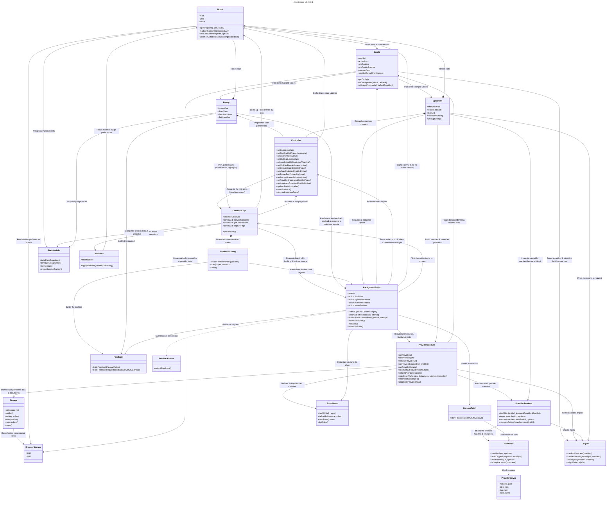

# Architecture

This diagram shows the modules of the Klikkikuri Paatti extension and the paths between them. It is maintained
by hand. If you change a module boundary, update it here.

Terms used below:

- **Provider** is a set of files that a **provider manifest** lists: site configs, Suola rules and Rahti data.
  The extension downloads each enabled provider and reads it locally. See [providers.md](providers.md). Do not
  mix up a provider manifest with the extension manifest, `manifest.json`.
- **Rahti** is Klikkikuri's data repository. Its provider manifest is the **default provider**. **Rahti data**
  (`data.json`, type `rahti-data`) is the correction database format, which any provider can publish. See
  [rahti](https://github.com/Klikkikuri/rahti).
- **Suola** is the WebAssembly module that normalizes and hashes URLs. The backend and the extension use the
  same module, so both sides agree on the **sign** (the hash) of a link. Its built-in normalization rules live in
  `suola/rules.yaml`. A provider can add its own named rule set. See [suola](https://github.com/Klikkikuri/suola).
- **Environment** is the stored user preference (`userPreferences.environment`: `free`, `paid`, or `development`)
  that picks the default providers and settings. It is not the **development server** (karikko, `make serve`),
  which runs on the developer's machine. The development environment makes the server reachable as a loopback
  provider; neither implies the other — see README.md, section "Development Server". Keep the prefixes straight:
  `devserver` names the server, `dev-capture` names the extension feature, and the content-script command is
  `capturePage`.

`src/provider.js` reads one provider manifest. `src/providers.js` keeps the provider list, refreshes each provider
into its own storage namespace, and installs each provider's Suola rules. `getConfig()` merges the data of the
enabled providers. For each link, the service worker makes one sign for each source in the precedence list of the
link's host (`signUrls()`). A provider with its own Suola rule set gets its own sign. The other sources share the
sign of the built-in rules. The content script looks up those signs (`getRahtiEntries()`).
[providers.md](providers.md#signs-and-lookups) tells the order of the sources.

When a developer runs `make sites-sync`, `tools/sites.mjs` resolves the default provider with `src/provider.js`.
It writes the site origins into `manifest.json`, because a store build can request only the origins that
`manifest.json` declares, and pins the Rahti commit in `sites.lock.json`. The extension contains no sites.

The popup and the in-page feedback card do not call the feedback server themselves. Both build the feedback
payload and give it to the service worker. The service worker builds the request from its configuration and makes
the one network call. `src/feedback.js` explains why.

| Class | Source |
|---|---|
| `BrowserStorage` | The `browser.storage` API |
| `Storage` | `src/storage.js` |
| `Model` | `src/model.js` |
| `Config` | `src/config.js` |
| `Controller` | `src/controller.js` |
| `ProvidersModule` | `src/providers.js` |
| `ProviderResolver` | `src/provider.js` |
| `SafeFetch` | `src/safe-fetch.js` |
| `Origins` | `src/options/origins.js` |
| `FaviconFetch` | `src/favicon-fetch.js` |
| `Feedback` | `src/feedback.js` |
| `BackgroundScript` | `src/background.js` (the service worker) |
| `ContentScript` | `src/contentScript.js` |
| `FeedbackDialog` | `src/components/feedback-dialog.js` |
| `StatsModule` | `src/stats.js` |
| `Modifiers` | `src/modifiers.js` |
| `SuolaWasm` | The globals of the `suola` WebAssembly module (`build/js.wasm`) |
| `Popup` | `src/options/popup.js` and the components that it imports |
| `OptionsUI` | `src/options/options.js` and `src/options/components/` |

In the diagram, a solid arrow is an import or a call, a dotted arrow is a network request, and `*--` means that
the module embeds the other one. A member in the form `action: name` is a runtime message, not a function.

